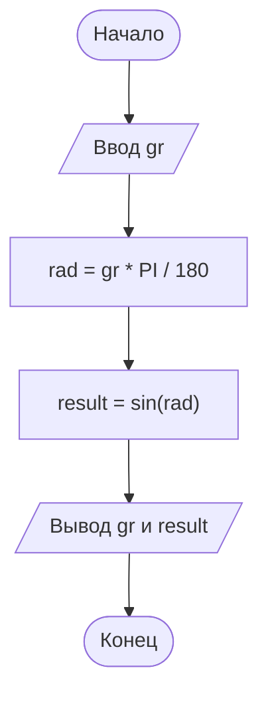
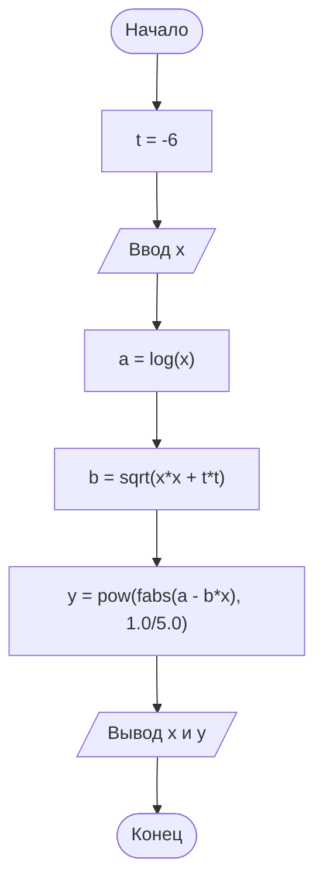
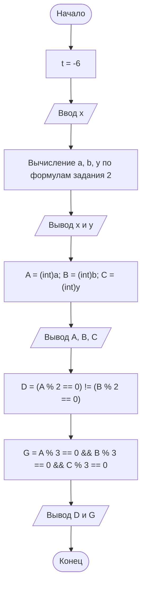

# Лабораторная работа № 5

Язык программирования: C. Вариант задания 2: 4.

## Задания

1. `zadanie 1 lab 5 .c` — ввод угла в градусах, перевод в радианы и вычисление синуса с шестью знаками после запятой.
2. `zadanie 2 lab 5 .c` — вычисление a = ln(x), b = sqrt(x² + t²), y = |a − bx|^(1/5), где t = −6. Для логарифма требуется x > 0.
3. `zadanie 3 lab 5.c` — вычисления задания 2 и проверка условий для целых частей A, B, C: ровно одно из A и B чётное; каждое из A, B, C кратно трём. Результат проверки: 1 — да, 0 — нет.

Каждый файл — отдельная программа со своей функцией main. Компилировать их нужно отдельно.

## Сборка через GCC

```sh
gcc "zadanie 1 lab 5 .c" -o task1 -lm
gcc "zadanie 2 lab 5 .c" -o task2 -lm
gcc "zadanie 3 lab 5.c" -o task3 -lm
```

В Windows PowerShell запуск: `./task1.exe`, `./task2.exe`, `./task3.exe`.
Исходники сохранены в UTF-8. Для отображения русского текста в консоли Windows может потребоваться команда `chcp 65001`.

## Контрольные примеры

| Задание | Ввод | Результат |
| --- | --- | --- |
| 1 | 30 | 0.500000 |
| 1 | 60 | 0.866025 |
| 1 | 90 | 1.000000 |
| 2 | 2.7 | y = 1.7576 |
| 3 | 2.7 | A = 0, B = 6, C = 1; оба условия — 0 |

## Блок-схемы

### Задание 1



### Задание 2



### Задание 3



## Вывод

Изучены математические функции, перевод градусов в радианы, получение целой части числа и составление логических выражений на языке C.
